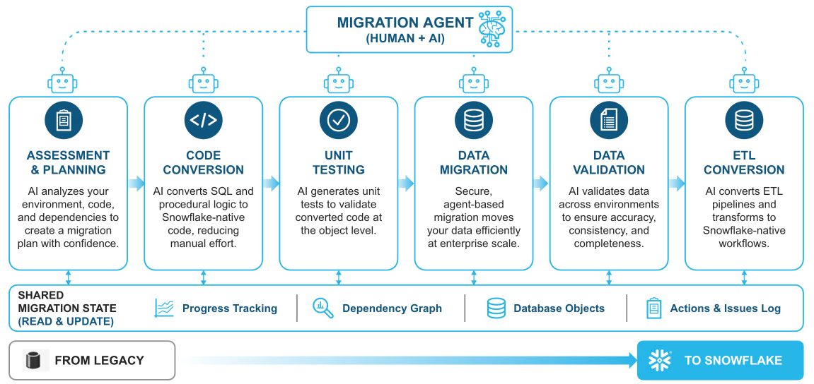

# Migrate Azure SQL to Snowflake, Wave by Wave

**Hands-on lab - AIM workshop for SI partners**

## Why are we here?

Most partner migrations do not start with "move everything". They start with a thin
slice that proves the whole pipeline. In this lab you migrate **Wave 1** of a live
Azure SQL Database to Snowflake with the SnowConvert AI migration agent in
[Cortex Code](https://docs.snowflake.com/en/user-guide/cortex-code/cortex-code),
then see how Wave 2 and an SSIS package follow the same loop.

## The Snowflake AIM Agent for Data Warehouses

The [Snowflake AIM Agent for Data Warehouses](https://docs.snowflake.com/en/migrations/aim-for-datawarehouses/intro),
powered by Snowflake CoCo, is an AI-assisted orchestrator that guides a migration
team through each stage: assessment and planning, code conversion, unit testing,
data migration, data validation and ETL conversion. Every stage reads and updates
a shared migration state (progress, dependency graph, database objects, actions log).

*Source: Snowflake documentation.* This lab walks those stages in order for Wave 1.

You will not paste one giant prompt. You give the agent a handful of short
instructions and read what it did after each one.

## What you will do

| Step | What happens |
|---|---|
| Account | PAT policy, PAT, `init.sql` |
| Source | Connect to Azure SQL, extract objects |
| Plan | Define Wave 1, convert, assess, estimate |
| Migrate | Deploy objects, move data on SPCS |
| Prove | Validate data, test code, review dashboard and git trail |

!!! tip "Ready to start?"
    Begin with [Lab 00 - Prerequisites](00-prerequisites.md).
